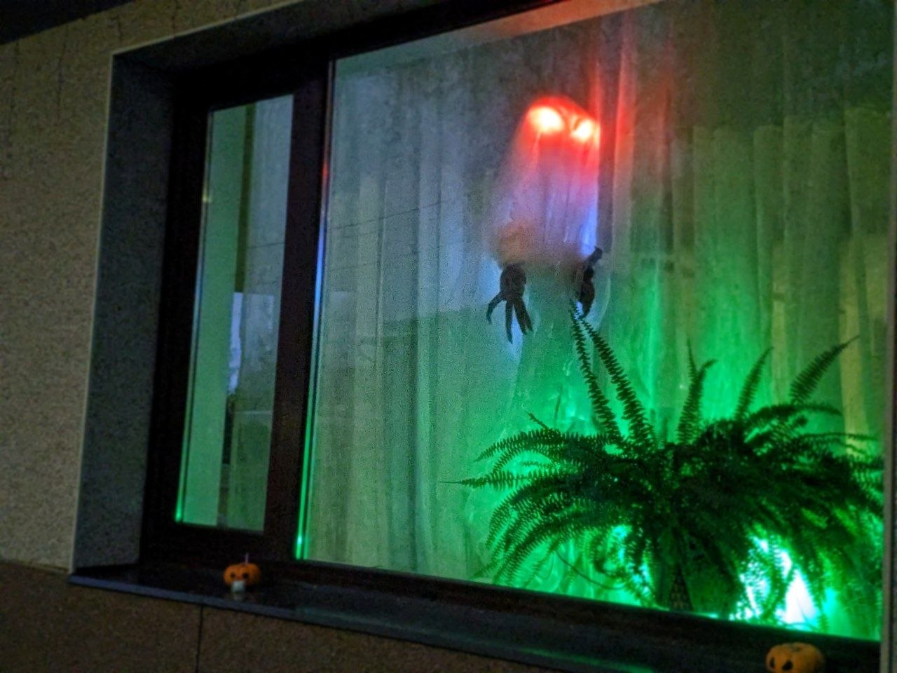
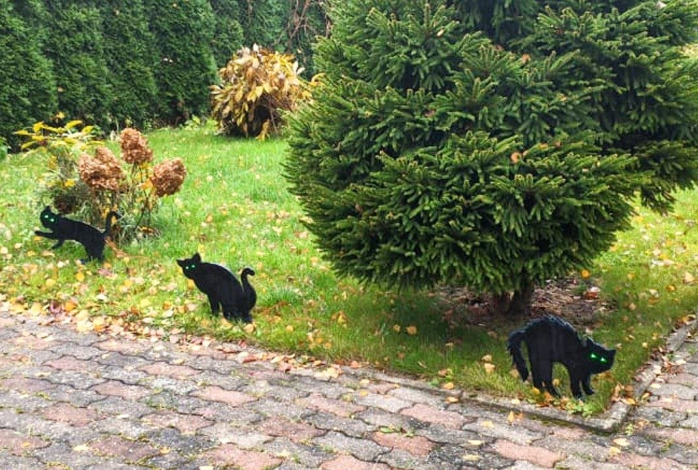
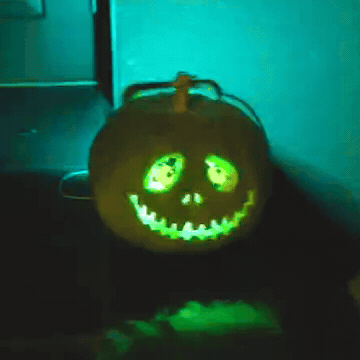

# Spooky circuits

A collection of DIY Halloween decoration projects (powered mostly by Raspberry Pi Pico).

| Project | Board | What it does |
|---|---|---|
| 👻 Ghost (2026) | Waveshare RP2040-Zero | NeoPixel ghost with a PIR-triggered jump-scare |
| 🐈‍⬛ Halloween cats (2025) | Raspberry Pi Pico | Three cat silhouettes with glowing LED eyes |
| 🎃 Pumpkin Jack (2024) | YD-RP2040 | Pumpkin with LED-matrix eyes and inner NeoPixel glow |

## Common setup

All projects run on [CircuitPython](https://circuitpython.org/) 10.x on an RP2040 board.

1. Flash the CircuitPython UF2 for your board (hold BOOTSEL while plugging in, drop the `.uf2` file on the `RPI-RP2` drive).
2. Copy the project's main script to the `CIRCUITPY` drive as **`code.py`**.
3. Copy the required libraries (from the [Adafruit CircuitPython Bundle](https://circuitpython.org/libraries), matching your CircuitPython version) to `CIRCUITPY/lib/`.

**Power:** the projects can run from any 5 V USB source (power bank, phone charger).
NeoPixel rings and MAX7219 matrices take 5 V from the board's `5V`/`VBUS` pin. Connect all grounds together.
The brightness settings in each script also limit how much current the LEDs draw.

---

## 👻 Ghost (2026)

Script: [`ghost_2026/code.py`](ghost_2026/code.py)

At power-on, the ghost slowly fades in from darkness while the PIR sensor settles.
When idle, its pale cold-blue body "breathes", with a wisp drifting around it, and the icy-white eyes look around and blink now and then.
When motion is detected, there is a **jump-scare**: the eyes go black, then slam to blood-red, and the body strobes.
The ghost then stays in an "alert" mode, with red heartbeat eyes darting around and a body flickering in sickly green and purple with occasional lightning.
After about 14 s without motion, it calms back down to idle.

### Hardware

- Waveshare RP2040-Zero
- 2x 8-LED WS2812 (NeoPixel) rings: the eyes, chained
- 1x 12-LED WS2812 ring: the body
- PIR motion sensor (e.g. HC-SR501, output HIGH on motion)

### Wiring

| RP2040-Zero | Connects to |
|---|---|
| GP15 | DIN of eye ring A; DOUT of ring A -> DIN of eye ring B |
| GP6 | DIN of body ring |
| GP0 | PIR `OUT` |
| 5V | VCC of all rings and of the PIR |
| GND | GND of all rings and of the PIR |

Optional: a ~330 ohm resistor in series with each data line, and a ~470 uF capacitor across the rings' 5V/GND.

### Software

- Libraries: `neopixel`, `adafruit_ticks`, `asyncio` (already included in [`ghost_2026/lib/`](ghost_2026/lib/), so copy that whole folder to `CIRCUITPY/lib/`)
- Settings are in the `CONFIG` block at the top of the script:
  - pins and pixel counts
  - `PIXEL_ORDER` (GRB/RGB)
  - brightness
  - eye-ring rotation and mirroring (`EYE_A_OFFSET`, `EYE_B_OFFSET`, `EYE_B_MIRRORED`)
  - PIR timings
  - the colour palette

---

## 🐈‍⬛ Halloween cats (2025)

Script: [`cats_2025/HalloweenCats.py`](cats_2025/HalloweenCats.py)

There are three cat silhouettes, cut out using the template in [`HalloweenCats_sketch.pdf`](cats_2025/HalloweenCats_sketch.pdf) (the CorelDRAW source is `HalloweenCats_sketch.cdr`). Each cat has a pair of glowing LED eyes.
The eyes "breathe" slowly, with each cat out of phase with the others, and blink at random.
Now and then, a lightning flash makes all three cats flicker together.

### Hardware

- Raspberry Pi Pico
- 6 LEDs (2 per cat)
- 6 current-limiting resistors (~100–330 ohm, depending on LED colour and the brightness you want)

### Wiring

| Pico | Connects to |
|---|---|
| GP6 | Cat 1 eyes |
| GP10 | Cat 2 eyes |
| GP14 | Cat 3 eyes |
| GND | All LED cathodes |

Each eye is wired as GPIO pin -> resistor -> LED anode (+), with the LED cathode (−) to GND.
The two eyes of a cat are in parallel on the same pin, each with its own resistor.
Keep the total current per pin low (a few mA per LED is plenty; brightness is capped in software anyway).
Use PWM-capable pins for smooth fades. All Pico GPIOs support PWM.
If you wire the LEDs to sink current from 3V3 instead (anode to 3V3, cathode -> resistor -> pin), set `"invert": True` in `PINS`.

### Software

- Libraries: `asyncio`, `adafruit_ticks` (`pwmio`, `digitalio` are built in)
- Settings:
  - `PINS`
  - `BRIGHTNESS_LIMIT`, the global brightness cap (default 5%)
  - `GAMMA`
  - `PWM_FREQUENCY`
  - per-cat effect parameters (breathing period/phase, blink interval, lightning cooldown) in `main()`

---

## 🎃 Pumpkin Jack (2024)

Script: [`pumpkin_Jack_2024/combined_eyes_and_neopixels.py`](pumpkin_Jack_2024/combined_eyes_and_neopixels.py)

A pumpkin with two 8x8 LED-matrix eyes that blink and glance around.
There are three eye styles: `"round"`, `"evil"`, or `"round,evil"`, which switches between the two after a few blinks.
Inside the pumpkin, two NeoPixel rings add the glow: one slowly cycles through the rainbow and the other breathes green.

### Hardware

- YD-RP2040 (the script turns off its onboard NeoPixel on GP23)
- 2x MAX7219 8×8 LED matrix modules: the eyes
- 2x 12-LED WS2812 (NeoPixel) rings

### Wiring

The two matrices share the SPI clock and data lines, and each has its own chip-select:

| YD-RP2040 | Connects to |
|---|---|
| GP2 | `CLK` of both matrices |
| GP3 | `DIN` of both matrices |
| GP5 | `CS` of left-eye matrix |
| GP6 | `CS` of right-eye matrix |
| GP28 | DIN of NeoPixel ring 1 (rainbow background outside) |
| GP29 | DIN of NeoPixel ring 2 (breathing green inside the head) |
| 5V | VCC of both matrices and both rings |
| GND | GND of both matrices and both rings |

### Software

- Libraries: `adafruit_max7219`, `adafruit_framebuf`, `adafruit_bus_device`, `neopixel`, `asyncio`, `adafruit_ticks` (`rainbowio` is built in)
- Settings: `EYE_MODE`, NeoPixel `brightness`, `num_pixels`
- [`tuple_vs_uint64.py`](pumpkin_Jack_2024/tuple_vs_uint64.py) is a desktop helper that converts eye frames between Python tuples and the `uint64` format used by the [LED Matrix Editor](https://xantorohara.github.io/led-matrix-editor/). It can also mirror frames horizontally.
